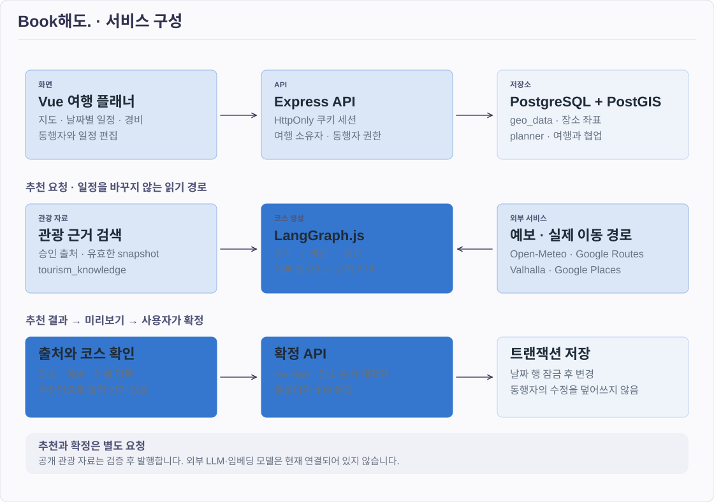

<h1 align="center">Book해도.</h1>

홋카이도 여행을 지도에서 고르고, 날짜별 일정으로 묶고, 날씨가 바뀌면 근거와 함께 대안 코스를 받아 보는 여행 계획 웹 서비스

홋카이도 12개 관광권의 장소를 지역·테마·키워드로 찾고, 동행자와 함께 날짜별 일정과 경비를 관리합니다. 일정이 정해진 날에는 그날의 예보와 공개 관광 자료를 바탕으로 실내 대안이나 하루 코스를 추천받고, 경로를 미리 본 뒤 확정할 수 있습니다. 장소 상세에는 원문 이름과 출처, Google 리뷰 중 일본어 리뷰 비율을 함께 보여 줍니다.

## 전체 아키텍처

  

| 흐름 | 설명 |
|------|------|
| 화면 → API | Vue 앱이 같은 출처의 `/api`를 호출하고, 로그인 상태는 HttpOnly 쿠키 세션으로 유지 |
| 일정 · 협업 | Express가 세션과 여행 접근 권한을 확인한 뒤 트랜잭션으로 일정 · 메모 · 경비 · 초대를 저장 |
| 하루 코스 추천 | LangGraph 그래프가 관광 자료 검색 → 예보 조회 → 코스 생성 → 검증 → 경로 미리보기 → 출처 재확인 순서로 실행 |
| 외부 정보 | 장소 상세·리뷰는 Google Places, 대중교통 경로는 Google Routes, 도보·차량·자전거 경로는 Valhalla, 날씨는 Open-Meteo |
| 데이터 적재 | OSM 추출본을 Python으로 정제해 `geo_data`에, 승인된 공개 관광 CSV를 수집·검증해 `tourism_knowledge`에 적재 |

DB는 하나의 PostgreSQL 안에서 schema를 셋으로 나눕니다.

| schema | 내용 |
|--------|------|
| `geo_data` | OSM 기반 장소 카탈로그 (PostGIS 좌표) |
| `tourism_knowledge` | 공개 관광 자료의 출처 · 발행 snapshot · 철회 기록 |
| `planner` | 사용자 · 세션 · 여행 · 일정 · 협업 · 요청 제한 카운터 |

## 각 기술 설명

### Vue 3 · Vite · TypeScript

`frontend/src`의 SPA입니다. `views/`에 랜딩 · 지역 안내 · 탐색 · 장소 상세 · 여행 목록 · 일정 편집 · 관리자 화면이 있고, Vue Router의 라우트 가드로 로그인이 필요한 화면을 막습니다. 일정 화면은 `useTripSynchronization`으로 동행자의 변경을 폴링해 반영합니다. 추천을 확정하다 응답을 잃으면 `recommendation-recovery.ts`가 결과 불명확 상태를 sessionStorage에 남기고, 사용자가 현재 일정을 다시 조회해 확인하도록 합니다.

### Google Maps JavaScript API

`TravelMap.vue`가 Maps JS를 비동기로 불러와 장소 마커와 이동 경로 polyline을 그립니다. Google Routes가 돌려준 encoded polyline은 `geometry` 라이브러리로 디코딩해 실제 경로선으로 그립니다.

### Express 5 · Zod

`server/app.ts`가 미들웨어와 라우터(`routes/auth`, `trips`, `catalog`, `providers`, `ai-recommendations`, `health`)를 묶습니다. 요청 본문과 외부 API 응답은 Zod 스키마로 검증하고, helmet으로 보안 헤더를, `express-rate-limit`과 PostgreSQL 저장소(`PostgresRateLimitStore`)로 여러 프로세스가 공유하는 요청 제한을 적용합니다. 추천 핸들러에는 15초 처리 예산(`operation-budget.ts`)을 걸어 클라이언트가 연결을 끊으면 진행 중인 외부 호출도 함께 중단합니다.

### 인증 · 세션

비밀번호는 Node `crypto`의 scrypt로 해시합니다. 로그인하면 임의 토큰을 `kita_session` 쿠키(HttpOnly, SameSite=Lax)로 내려주고, DB에는 토큰의 해시만 저장합니다. 여행별 권한은 `auth/trip-access.ts`가 소유자 · 동행자 역할로 확인합니다.

### LangGraph.js

`server/ai/tourism-graph.ts`의 `StateGraph`가 하루 코스 추천의 실행 순서를 정합니다.

| 노드 | 하는 일 |
|------|--------|
| `interpret` | 현재 일정에서 지역 · 중심 좌표 · 유지할 장소 · 관심사 정리 |
| `retrieve` | `tourism_knowledge`와 기존 장소에서 후보와 근거 검색 (반경 10 → 15 → 20km) |
| `weather_lookup` | 첫 검색일 때만 Open-Meteo 예보 조회 |
| `generate` | 규칙 기반으로 코스 생성. 외부 생성기를 연결할 수 있지만 검색된 장소 ID만 받도록 Zod로 제한 |
| `validate` | 조건을 만족하는 코스가 없으면 검색 3회까지 `retrieve`로 되돌아감 |
| `route_preview` | 선택한 코스의 경로 조회 |
| `revalidate_sources` | 응답 직전에 출처의 권리 · snapshot · 적용 기간 · 철회 여부를 다시 확인 |

현재 저장소에는 LLM이나 임베딩 모델이 연결되어 있지 않으며, 코스는 규칙 기반 생성기가 만듭니다. 추천 결과는 일정을 바꾸지 않는 미리보기이고, 사용자가 확정하면 `PATCH .../day-alternatives`가 조회 당시 revision과 장소 순서를 비교한 뒤 저장합니다.

### PostgreSQL · PostGIS

`docker-compose.yml`의 `postgis/postgis:17-3.5` 컨테이너를 씁니다. 장소 검색과 거리 계산은 PostGIS 공간 쿼리로 처리하고, 스키마 변경은 `db/migrations/`의 번호 순 SQL을 `scripts/migrate-db.ts`가 적용합니다. 일정 저장은 날짜 단위 잠금과 revision 증가를 한 트랜잭션에서 처리해 동시 편집 충돌을 409로 돌려줍니다. 백업 · 복원 훈련 스크립트(`backup-db.ts`, `restore-drill.ts`)가 있습니다.

### Google Places · Routes API

`server/place-details.ts`가 Places API (New)로 장소 사진 · 평점 · 리뷰를 가져오고, 리뷰의 원문 언어 코드로 일본어 리뷰 비율을 계산해 추천 근거로 씁니다. `server/providers.ts`는 대중교통(`TRANSIT`) 구간만 Google Routes API로 조회합니다. 응답은 `provider-cache.ts`의 TTL 캐시에 저장해 같은 요청의 반복 호출을 줄입니다.

### Valhalla

`docker-compose.valhalla.yml`이 Geofabrik의 홋카이도 OSM 추출본으로 Valhalla 타일을 만들어 로컬 8002 포트에서 실행합니다. 도보 · 차량 · 택시 · 자전거 구간을 `pedestrian`, `auto`, `bicycle` costing으로 계산하며, 동시 실행 수와 대기열 길이를 `valhalla-gate.ts`로 제한합니다.

### Open-Meteo

`providers.ts`의 `forecast`가 좌표별 일 단위 예보를 가져옵니다. 10일치 예보를 한 번에 받아 같은 좌표의 다른 날짜 조회에 캐시를 재사용하고, `shared/weather-policy.ts`의 기준으로 악천후 여부를 판단해 실내 대안 추천에 씁니다.

### Python 데이터 적재

`scripts/prepare_hokkaido_data.py`가 osmium으로 OSM 추출본에서 관광지 · 음식점 등의 POI를 뽑고 shapely로 geometry를 정리하면, `load_postgis.py`가 psycopg로 `geo_data`에 적재합니다. 공개 관광 자료는 `scripts/tourism/collector.py`가 승인된 출처(`ops/tourism/source-policy.json`)만 수집해 원본 SHA-256과 수집 이력을 SQLite에 기록하고, `normalize.py`가 인코딩 · 열 · 좌표 · 날짜를 검증한 뒤 `publish.ts`가 한 트랜잭션으로 새 snapshot을 발행합니다.

### Prometheus 지표 · 로그

`server/observability/metrics.ts`가 경로별 요청 수 · 지연 시간 · 중단 수를 Prometheus 텍스트 형식으로 `/metrics`에 노출합니다. 운영 환경에서는 `METRICS_TOKEN` Bearer 인증이 필요합니다. 경보 규칙은 `ops/prometheus/alerts.yml`에 있습니다.

### 테스트 · CI

Vitest와 Supertest로 도메인 규칙 · API 계약 · 권한 · 동시성 · 추천 그래프를 검사하고, Playwright로 데스크톱 · 모바일의 추천 · 저장 복구 · 초대 흐름을 브라우저에서 확인합니다. GitHub Actions(`ci.yml`)는 PostGIS 서비스 컨테이너를 띄워 의존성 감사 → lint · typecheck · format → 마이그레이션 → 테스트 → Python 수집기 테스트 → 부하 기준 → OpenAPI · DBML 검사 → 빌드를 실행하고, 별도 job에서 Playwright E2E를 돌립니다. `operations-drill.yml`은 백업 · 복원 · 부하 훈련을 따로 실행합니다.

### OpenAPI · DBML

`scripts/write-api-spec.mjs`가 `docs/openapi-rest.json`과 Swagger UI용 `frontend/public/openapi.json`을 만들고, CI의 `spec:check`가 코드와 문서가 어긋나면 실패시킵니다. 데이터 모델은 `docs/erd.dbml`로 관리합니다.
