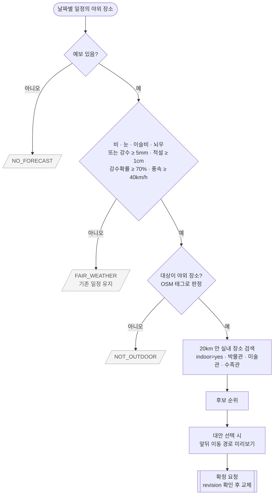
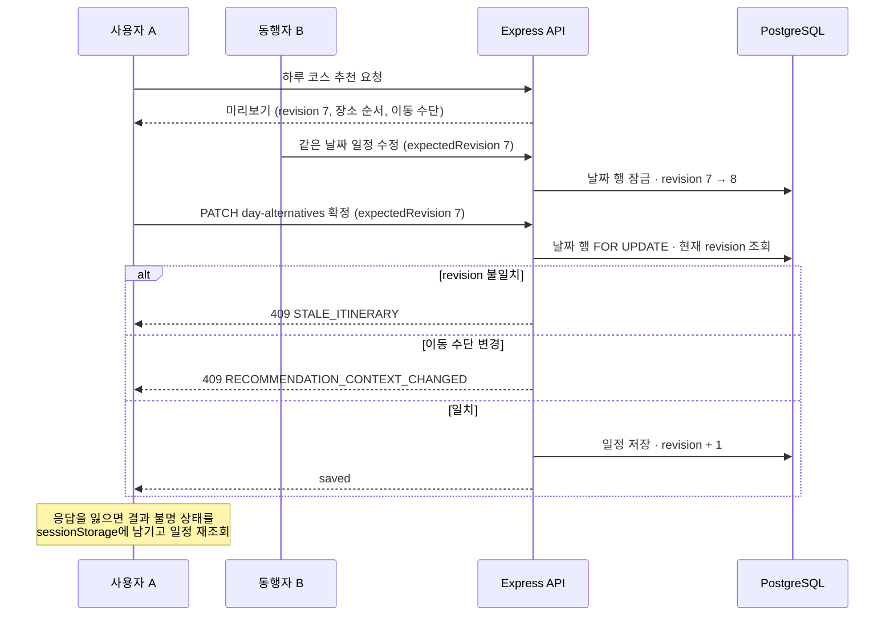
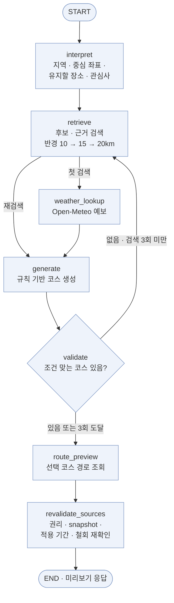
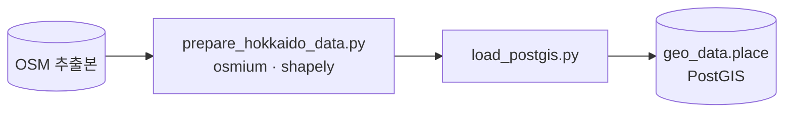
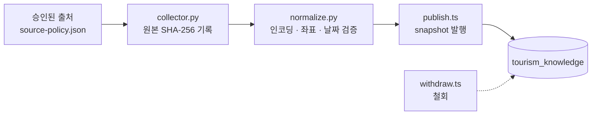

<p align="center"></p>

<h1 align="center">Book해도.</h1>

<p align="center">Vue · Express · PostgreSQL / PostGIS · LangGraph.js</p>

[구조](#architecture) · [주요 흐름](#workflow) · [설계 선택](#핵심-설계-결정) · [실행](#실행)

<p align="center">홋카이도 여행을 지도에서 고르고, 날짜별 일정으로 묶고, 날씨가 바뀌면 근거와 함께 대안 코스를 받아 보는 여행 계획 웹 서비스</p>


홋카이도 12개 관광권의 장소를 지역·테마·키워드로 찾고, 동행자와 함께 날짜별 일정과 경비를 관리합니다. 일정이 정해진 날에는 그날의 예보와 공개 관광 자료를 바탕으로 실내 대안이나 하루 코스를 추천받고, 경로를 미리 본 뒤 확정할 수 있습니다. 장소 상세에는 원문 이름과 출처, Google 리뷰 중 일본어 리뷰 비율을 함께 보여 줍니다.

## 화면

| 첫 화면 | 새 여행 만들기 | 여행 플래너 |
|:-------:|:--------------:|:-----------:|
|  |  |  |

로컬에서 `npm run dev`로 실행해 촬영했습니다. 장소 카탈로그를 적재하지 않은 DB(`/api/health`의 `places: 0`)이므로 플래너의 일정은 비어 있고, 장소 데이터는 [데이터 적재](#데이터-적재)를 따라 넣어야 채워집니다.

<a id="architecture"></a>

## 구조 한눈에 보기

<p align="center">
  
</p>

추천은 읽기 전용 미리보기입니다. 일정 변경은 사용자의 확정 요청과 버전 검증을 거칩니다.

| 흐름 | 설명 |
|------|------|
| 화면 → API | Vue 앱이 같은 출처의 `/api`를 호출하고, 로그인 상태는 HttpOnly 쿠키 세션으로 유지 |
| 일정 · 협업 | Express가 세션과 여행 접근 권한을 확인한 뒤 트랜잭션으로 일정 · 메모 · 경비 · 초대를 저장 |
| 하루 코스 추천 | LangGraph 그래프가 관광 자료 검색 → 예보 조회 → 코스 생성 → 검증 → 경로 미리보기 → 출처 재확인 순서로 실행 |
| 외부 정보 | 장소 상세·리뷰는 Google Places, 대중교통 경로는 Google Routes, 도보·차량·자전거 경로는 Valhalla, 날씨는 Open-Meteo |
| 데이터 적재 | OSM 추출본을 Python으로 정제해 `geo_data`에, 승인된 공개 관광 CSV를 수집·검증해 `tourism_knowledge`에 적재 |

DB는 하나의 PostgreSQL 안에서 schema를 셋으로 나눕니다.

| schema | 내용 |
|--------|------|
| `geo_data` | OSM 기반 장소 카탈로그 (PostGIS 좌표) |
| `tourism_knowledge` | 공개 관광 자료의 출처 · 발행 snapshot · 철회 기록 |
| `planner` | 사용자 · 세션 · 여행 · 일정 · 협업 · 요청 제한 카운터 |

<a id="workflow"></a>

## 주요 흐름


## 세부 동작

<details>
<summary><b>1. 날씨에 따른 실내 대안</b></summary>

일정에 넣은 야외 장소의 날짜 예보가 아래 기준에 걸리면 20km 안의 실내 장소를 대안으로 제시합니다. 기준은 추천용 값이며 공식 기상 특보와는 다릅니다(`shared/weather-policy.ts`).



</details>

<details>
<summary><b>2. 추천 확정과 동시 편집</b></summary>

추천은 일정을 바꾸지 않는 미리보기이고, 확정할 때 조회 당시의 revision · 장소 순서 · 이동 수단이 그대로인지 확인합니다.



</details>


## 핵심 설계 결정

| 결정 | 방식 | 위치 |
|------|------|------|
| 일정 저장은 revision으로 충돌을 감지 | 동행자가 같은 날을 동시에 고칠 수 있어, 쓰기 요청이 `expectedRevision`을 보냅니다. 현재 값과 다르면 409 `STALE_ITINERARY`, 값이 없으면 428 `REVISION_REQUIRED`를 돌려주고, 장소 순서를 바꿀 때는 해당 날짜의 항목 행을 `FOR UPDATE`로 잠급니다. | `server/itinerary-version.ts`, `itinerary-write.ts`, `routes/trips.ts` |
| 추천은 미리보기, 확정은 별도 요청 | 추천을 계산하는 사이 일정이나 이동 수단이 바뀌면 409 `RECOMMENDATION_CONTEXT_CHANGED`로 거절합니다. 확정 응답을 잃으면 `recommendation-recovery.ts`가 결과 불명 상태를 sessionStorage에 남기고, 사용자가 현재 일정을 다시 조회해 확인합니다. | `server/routes/ai-recommendations.ts`, `frontend/src/recommendation-recovery.ts` |
| 근거는 응답 직전에 다시 확인 | `revalidate_sources` 노드가 출처의 권리 · snapshot · 적용 기간 · 철회 여부를 다시 검사합니다. 공개 자료는 한 트랜잭션으로 새 snapshot을 발행하고, 철회는 별도 스크립트로 처리합니다. | `server/ai/tourism-graph.ts`, `scripts/tourism/publish.ts`, `withdraw.ts` |
| 외부 호출에 시간 · 동시성 상한 적용 | 추천 요청에는 15초 처리 예산을 걸어 클라이언트가 연결을 끊으면 진행 중인 외부 호출도 중단합니다. 자체 호스팅 Valhalla는 동시 실행 수와 대기열 길이(`VALHALLA_MAX_CONCURRENT`, `VALHALLA_MAX_QUEUE`)를 제한하고, Places · Routes · 예보 응답은 TTL 캐시에 둡니다. 요청 제한 카운터는 PostgreSQL에 저장해 여러 프로세스가 공유합니다. | `operation-budget.ts`, `valhalla-gate.ts`, `provider-cache.ts` |

## 하루 코스 추천 그래프

`server/ai/tourism-graph.ts`의 LangGraph.js `StateGraph`가 실행 순서를 정합니다.



| 노드 | 하는 일 |
|------|--------|
| `interpret` | 현재 일정에서 지역 · 중심 좌표 · 유지할 장소 · 관심사 정리 |
| `retrieve` | `tourism_knowledge`와 기존 장소에서 후보와 근거 검색 (반경 10 → 15 → 20km) |
| `weather_lookup` | 첫 검색일 때만 Open-Meteo 예보 조회 |
| `generate` | 규칙 기반으로 코스 생성. 외부 생성기를 연결할 수 있지만 검색된 장소 ID만 받도록 Zod로 제한 |
| `validate` | 조건을 만족하는 코스가 없으면 검색 3회까지 `retrieve`로 되돌아감 |
| `route_preview` | 선택한 코스의 경로 조회 |
| `revalidate_sources` | 응답 직전에 출처의 권리 · snapshot · 적용 기간 · 철회 여부를 다시 확인 |

현재 저장소에는 LLM이나 임베딩 모델이 연결되어 있지 않으며, 코스는 규칙 기반 생성기가 만듭니다. 추천 결과는 일정을 바꾸지 않는 미리보기이고, 사용자가 확정하면 `PATCH .../day-alternatives`가 조회 당시 revision과 장소 순서를 비교한 뒤 저장합니다.

## 데이터 적재





- **장소 카탈로그**: `scripts/prepare_hokkaido_data.py`가 osmium으로 OSM 추출본에서 관광지 · 음식점 등의 POI를 뽑고 shapely로 geometry를 정리하면, `load_postgis.py`가 psycopg로 `geo_data`에 적재합니다.
- **공개 관광 자료**: `scripts/tourism/collector.py`가 승인된 출처(`ops/tourism/source-policy.json`)만 수집해 원본 SHA-256과 수집 이력을 SQLite에 기록하고, `normalize.py`가 인코딩 · 열 · 좌표 · 날짜를 검증한 뒤 `publish.ts`가 한 트랜잭션으로 새 snapshot을 발행합니다.

## 실행

Node.js(`package.json`의 `engines`: `^22.13 || ^24 || >=26`)와 Docker가 필요합니다.

```bash
cp .env.example .env     # VITE_GOOGLE_MAPS_API_KEY 입력
npm install
npm run db:up            # PostGIS 컨테이너 (localhost:5433)
npm run db:init          # 스키마 준비
npm run dev              # API(3001) + Vite(5173)
```

장소 카탈로그는 별도로 적재합니다. 저장소 루트에 OSM 추출본(`hokkaido-*.osm.pbf`, 기본값 `hokkaido-260907.osm.pbf`)과 `Hokkaido_OD_GeoDataBase.csv`를 두고 실행합니다.

```bash
npm run data:setup && npm run data:prepare && npm run data:load
```

자체 Valhalla는 `docker compose -f docker-compose.valhalla.yml up -d`로 띄우고 `VALHALLA_BASE_URL=http://127.0.0.1:8002`를 지정합니다. 기본값은 공개 데모 서버이며 운영에서는 자체 또는 라이선스를 가진 엔드포인트가 필요합니다.

| 환경변수 | 용도 |
|----------|------|
| `DATABASE_URL` | PostgreSQL 접속 (기본 예시는 `localhost:5433`) |
| `VITE_GOOGLE_MAPS_API_KEY` | 브라우저용 Google Maps 키 |
| `GOOGLE_MAPS_SERVER_API_KEY` | 서버용 키. 개발에서는 비우면 위 키를 쓰고, 운영에서는 별도 키가 필요 |
| `APP_ORIGINS` | 허용 출처 목록. 운영에서는 HTTPS |
| `VALHALLA_BASE_URL` | 도보 · 차량 · 자전거 경로 서버 |
| `METRICS_TOKEN` | 운영에서 `/internal/metrics` 접근용 Bearer 토큰 (32자 이상) |

## 검증

```bash
npm run lint && npm run typecheck && npm run spec:check
npm run test:ci          # Vitest (PostgreSQL 필요)
npm run test:e2e         # Playwright
```

Vitest와 Supertest로 도메인 규칙 · API 계약 · 권한 · 동시성 · 추천 그래프를 검사하고, Playwright로 데스크톱 · 모바일의 추천 · 저장 복구 · 초대 흐름을 브라우저에서 확인합니다. GitHub Actions(`ci.yml`)는 PostGIS 서비스 컨테이너를 띄워 의존성 감사 → lint · typecheck · format → 마이그레이션 → 테스트 → Python 수집기 테스트 → 부하 기준 → OpenAPI · DBML 검사 → 빌드를 실행하고, 별도 job에서 Playwright E2E를 돌립니다. `operations-drill.yml`은 백업 · 복원 · 부하 훈련을 따로 실행합니다.

## 기술 구성

| 기술 | 용도 | 위치 |
|------|------|------|
| Vue 3 · Vite · TypeScript | SPA. 라우트 가드로 로그인 화면을 막고, 일정 화면은 `useTripSynchronization`으로 동행자 변경을 폴링 | `frontend/src` |
| Google Maps JavaScript API | 장소 마커와 이동 경로 polyline. Routes의 encoded polyline을 `geometry` 라이브러리로 디코딩 | `TravelMap.vue` |
| Express 5 · Zod | 라우터 묶음, 요청 본문과 외부 API 응답의 Zod 검증, helmet 보안 헤더 | `server/app.ts` |
| 인증 · 세션 | scrypt 해시, `kita_session` 쿠키(HttpOnly, SameSite=Lax), DB에는 토큰 해시만 저장. 여행별 소유자 · 동행자 권한 | `server/auth/` |
| PostgreSQL · PostGIS | `postgis/postgis:17-3.5`. 공간 쿼리로 검색 · 거리 계산, `db/migrations/`의 번호 순 SQL을 적용. 백업 · 복원 훈련 스크립트 포함 | `scripts/migrate-db.ts`, `backup-db.ts`, `restore-drill.ts` |
| Google Places · Routes | Places(New)로 사진 · 평점 · 리뷰를 가져와 일본어 리뷰 비율을 계산하고, 대중교통(`TRANSIT`) 구간만 Routes로 조회 | `place-details.ts`, `providers.ts` |
| Valhalla | Geofabrik 홋카이도 추출본으로 타일을 만들어 로컬 8002 포트에서 실행. `pedestrian` · `auto` · `bicycle` costing | `docker-compose.valhalla.yml` |
| Open-Meteo | 10일치 예보를 한 번에 받아 같은 좌표의 다른 날짜 조회에 캐시를 재사용하고, `shared/weather-policy.ts` 기준으로 악천후를 판단 | `providers.ts` |
| Prometheus | 경로별 요청 수 · 지연 시간 · 중단 수를 `/internal/metrics`에 노출. 경보 규칙은 `ops/prometheus/alerts.yml` | `server/observability/metrics.ts` |
| OpenAPI · DBML | `write-api-spec.mjs`가 `docs/openapi-rest.json`과 Swagger UI용 JSON을 생성하고, CI의 `spec:check`가 코드와 어긋나면 실패. 모델은 `docs/erd.dbml` | `scripts/write-api-spec.mjs` |
