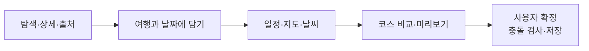
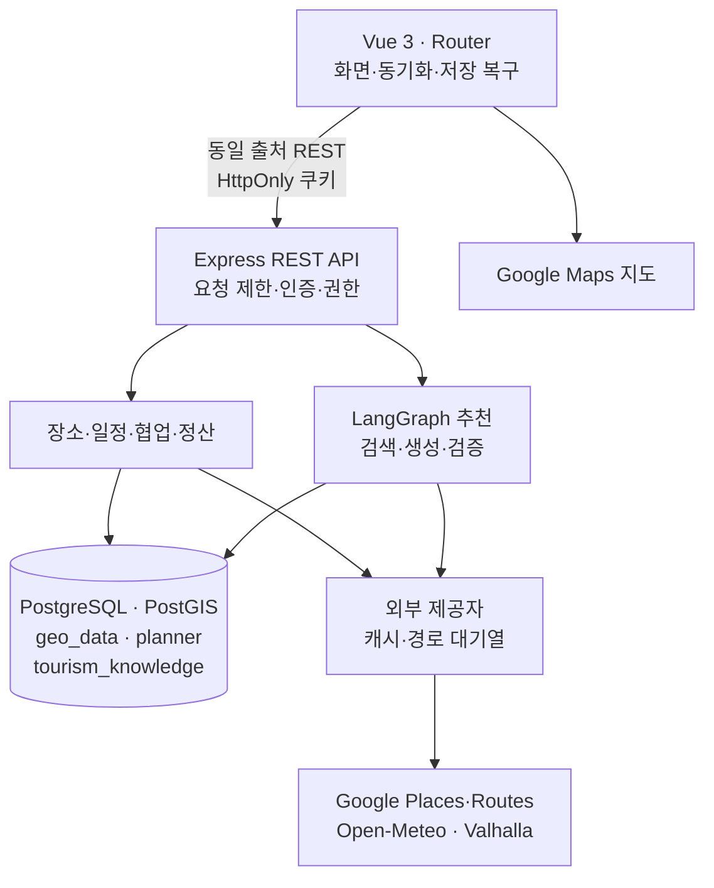
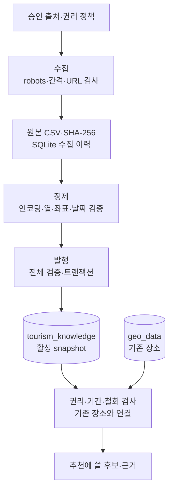
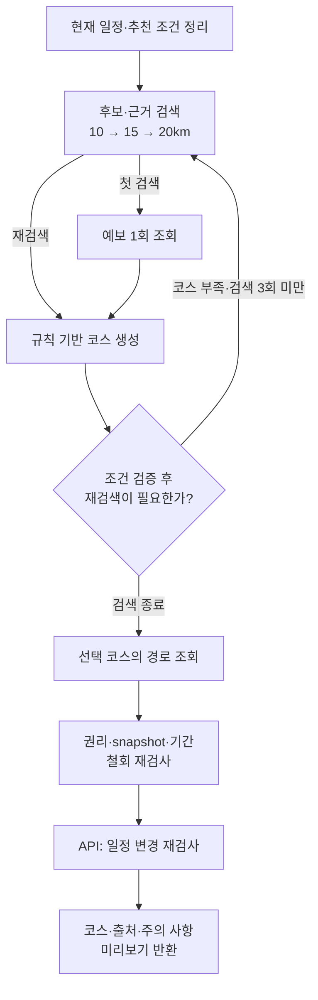
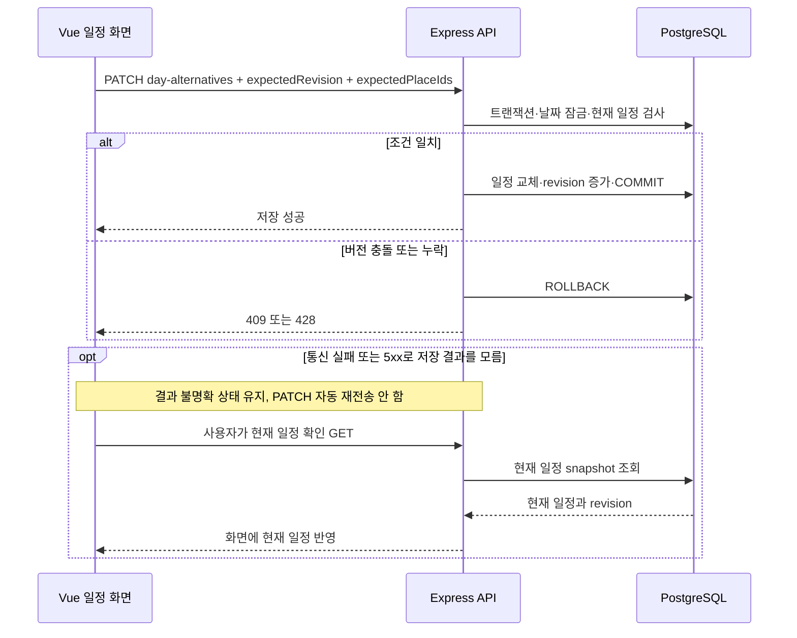
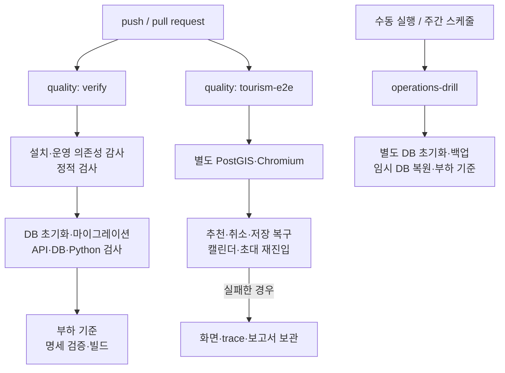

<p align="center"></p>

<h1 align="center">가고 싶은 곳을<br>하나의 여행으로 .</h1>
<p align="center">홋카이도 12개 관광권 · 지도 탐색 · 날짜별 일정 · 근거를 보여주는 추천</p>

<p align="center">
  
  
  
  
  
  <br>
  
  
  
  
  
</p>

[서비스 소개](#서비스-소개) · [v2 변경점](#v2에서-달라진-점) · [아키텍처와 워크플로](#시스템-아키텍처) · [로컬 실행](#로컬-실행) · [CI와 검증](#검증)

## 서비스 소개

Book해도는 소도시의 장소와 일본어 이름을 찾는 불편함, 여행 순서를 지도에 정리하는 어려움, 날씨가 달라졌을 때 일정을 다시 짜는 부담을 줄이는 웹 서비스입니다. 장소를 발견하고, 방문할 날짜에 담고, 지도에서 동선을 비교한 뒤 직접 일정을 확정합니다.

현재 `main`은 2026-10-20에 `ver2`를 통합한 코드입니다. Vue 화면, Express REST API, PostgreSQL/PostGIS 위에 **공개 관광 자료 검색과 LangGraph 추천 흐름**, **일정 충돌 검사와 저장 응답 유실 복구**를 연결했습니다. 기본 코스 생성은 규칙 기반이며 외부 LLM을 호출하지 않습니다.

단순히 가고 싶은 곳을 모아두는 목록이 아니라, **“어디를 갈까?”에서 “어떤 순서로 여행할까?”까지 이어주는 홋카이도 전용 여행 플래너**를 지향합니다. 여행 준비 중에는 지역과 취향으로 후보를 좁히고, 여행 중에는 날짜별 지도와 날씨를 보며 계획을 조정할 수 있습니다.

### 이런 여행자를 위해 만들었습니다

- 삿포로 같은 주요 도시뿐 아니라 홋카이도 소도시까지 직접 여행하고 싶은 사람
- 일본어 장소명을 찾고 다시 복사하는 번거로움 없이 한국어로 탐색하고 싶은 사람
- 흩어진 저장 목록을 날짜별 순서와 이동 동선으로 정리하고 싶은 사람
- 비나 눈 때문에 계획을 바꿔야 할 때, 근처 실내 장소나 하루 코스를 비교하고 싶은 사람

### 불편함을 해결하는 방식

| 여행 준비의 불편함 | Book해도의 접근 |
|---|---|
| 유명 도시·장소에 검색이 편중됨 | 12개 관광권의 수집 장소를 지역·키워드·테마로 탐색 |
| 일본어 장소명을 한국어로 찾기 어려움 | 한국어 검색 보조와 제공되는 한국어 상세정보, 현지 검색을 위한 원문 이름 유지 |
| 장소를 저장해도 이동 순서가 잘 보이지 않음 | 날짜별 목록·지도·구간 거리와 시간을 함께 확인 |
| 날씨가 달라지면 일정을 처음부터 다시 고민함 | 기존 동선 주변의 실내 대안·하루 코스를 비교한 뒤 직접 확정 |
| 익숙한 명소 외에 무엇을 볼지 판단하기 어려움 | 일본어 리뷰 표본이 있는 음식점·관광지 후보와 추천 근거 제공 |

일본어 리뷰는 새로운 후보를 발견하는 단서로 활용합니다. 작성자의 거주지·국적을 확인하거나 특정 장소를 “현지인 맛집”으로 인증하는 기능은 아닙니다.

## v2에서 달라진 점

| 영역 | 현재 구현 |
| --- | --- |
| 공개 관광 자료 | 승인된 HARP·삿포로 CSV를 수집·정제·검증하고 출처와 수집 시점이 있는 snapshot으로 발행 |
| 하루 코스 추천 | LangGraph가 자료 검색·예보·규칙 기반 생성·조건 검증·선택 코스의 경로 미리보기를 연결 |
| 근거 검증 | 출처의 권리·활성 상태, snapshot, 적용 기간과 철회를 응답 직전에 다시 확인 |
| 일정 보호 | 추천 전후의 revision·장소 순서·이동수단을 비교하고, 확정 저장에서도 충돌을 다시 검사 |
| 저장 복구 | 응답을 잃으면 결과 불명확 상태를 유지하고 현재 일정을 조회. 패널 닫기·날짜 변경·새로고침 이후에도 확인 가능 |
| 처리 한도 | 추천 핸들러의 15초 예산, 사용자별 추천 요청 제한, Valhalla 동시 실행·대기열 제한 |
| 검증 자동화 | 격리된 PostGIS에서 API·추천·복구·초대 흐름을 검사하고 별도 workflow로 백업·복원·부하 훈련 |

### 공개 관광 자료를 함께 보는 추천

하루 코스 추천에서 **공개 관광 자료 함께 보기**를 선택하면 LangGraph.js가 승인된 자료 검색 → 예보 조회 → 코스 생성 → 조건 검증 → 동선 미리보기를 연결합니다. 유지할 장소를 고를 수 있고, 자료 출처·라이선스·수집 시점·행사 미확정 상태를 확인한 뒤 기존 확정 API로 저장합니다. 공개 자료가 없으면 기존 장소 추천으로 이어집니다.

반복·날짜 미기재 행사는 개최 미확인 참고 목록으로 분리하고 과거 영업시간을 현재 정보처럼 사용하지 않습니다. 관광 자료를 기존 장소에 연결할 때는 이름·좌표·검토된 별칭을 확인합니다. [시설 대조](docs/research/tourism-facility-decisions-20261001.md), [지역 자료 확대](docs/research/tourism-source-expansion-20261001.md), [실제 적재 이력](docs/research/tourism-data-ingestion-20261001.md)에 당시 수집·연결 결과를 보존했습니다. 과거 적재 건수는 현재 운영 중인 시설·행사 수를 뜻하지 않습니다.

현재 기본 코스 생성은 규칙 기반입니다. 외부 LLM·번역·임베딩·AWS 스케줄러는 연결하지 않았으며, CSV 정제·공개 버전 발행은 운영자가 실행합니다. 설치·자료 적재·API·모델 확장 방법과 검증 범위는 [LangGraph 확장 안내](docs/tourism-langgraph.md)를 참고하세요.

## 주요 기능

### 동행자와 함께 준비하는 여행

일정 화면의 여행 준비 도구에서 **체크리스트 / 지출·정산 / 동행자·초대 / 여행 채팅** 패널을 열 수 있습니다. 시간표 캘린더에서 방문 시간을 수정하거나 캘린더를 숨길 수 있습니다. 공동·개인 지출은 구분하며 Excel 다운로드와 PDF 인쇄를 제공합니다. 지역 안내는 12개 지역의 사계절 추천·배경·축제·방문 제한을 제공합니다.

- **추천 표시 설정**: 처음에는 하루 코스 추천이 보입니다. ×로 숨기거나 상단 버튼으로 다시 표시할 수 있고, 이 브라우저의 여행별 선택을 기억합니다.
- **장소별 예상 비용**: 각 장소의 ‘예상 비용’에 엔화 예상 총액을 저장합니다. 순서 변경에도 메모·비용이 유지되며, 다른 장소로 교체하면 초기화됩니다. 미입력과 0엔은 구분합니다.
- **공동 체크리스트**: 준비 항목 추가·완료·삭제를 여행 단위로 저장합니다.
- **정산 계산기**: 실제 지출의 결제자·분담자를 선택합니다. JPY 정수 단위 균등분할로 나머지 1엔까지 배분하며, 누가 누구에게 얼마를 보내면 되는지 계산합니다. 송금 자체는 수행하지 않습니다.
- **초대와 공동 편집**: 소유자가 가입 이메일로 서비스 내 초대장을 보내거나 7일 유효·1회 수락 링크를 발급합니다. 수락한 동행자는 일정을 함께 수정하고 메모를 봅니다. 초대 관리와 여행 전체 삭제는 소유자만 가능합니다. 이메일 발송 서비스는 사용하지 않습니다.
- **여행 채팅·알림**: 열린 채팅은 약 6초마다, 초대 알림은 15초마다 갱신됩니다. 이전 대화를 더 불러올 수 있습니다. 일정 변경은 15초마다 확인 후 새로고침 안내를 표시하며 작성 중인 입력을 자동으로 덮어쓰지 않습니다.
- **회원 탈퇴**: 사용자명 옆 알림 → 계정 관리에서 비밀번호와 삭제 범위를 확인합니다. 소유 여행은 관련 데이터와 함께 삭제하고, 타인 소유 여행의 대화는 작성자를 익명 표시하며 정산 금액·식별자는 보존합니다. 관리자 계정은 먼저 회원 역할로 전환해야 합니다.

현재 데이터 구조는 `db/planner.sql`, `db/admin.sql`, `db/collaboration.sql`과 `db/migrations/`에 정의됩니다. 신규 DB는 `npm run db:init`, 기존 DB는 `npm run db:migrate`로 적용합니다. 개발 서버는 자동 적용하지만 운영 서버는 적용 이력만 검증합니다. 공유 일정의 순서·메모·예산·대안 저장은 날짜별 revision을 검사하며 충돌 시 409를 반환합니다. 예산과 실제 지출은 별도 데이터입니다.

검증: `tests/collaboration.test.ts`는 실제 PostgreSQL에서 초대 수락 전후 권한·외부인 차단·공동 메모/예산 보존·정산·초대 만료/취소·탈퇴를 검사합니다.
전체 검증 결과와 브라우저 확인 범위는 [공동 여행 기능 검증 기록](docs/collaboration-verification.md)에 정리했습니다.

| 화면 | 사용자가 할 수 있는 일 |
|---|---|
| 회원가입·로그인 | 계정 생성, 세션 인증, 로그아웃 및 만료 시 재로그인 |
| 홋카이도 안내 | 상단 메뉴에서 12개 지역의 사계절 추천·배경·축제·방문 제한 확인 |
| 발견하기 | 지역 소개 → 테마 선택 → 지도와 연결된 장소 목록 |
| 통합 검색 | `삿포로 공원`, `오타루 빈티지 옷가게`, 장소명 검색 |
| 장소 상세 | 원문 이름, 출처, 확인된 웹사이트, Google 사진·전체 평점·리뷰 |
| 나의 여행 | 여행 생성·이름 수정·삭제, 날짜별 일정과 메모 관리 |
| 여행 일정 | 순서 편집, 교통수단별 경로·거리·시간, 날짜의 날씨 |
| 대안 추천 | 실내 대체 장소 또는 하루 전체 코스 비교 → 미리보기 → 확정/취소 |
| 관리자 | 회원 검색, 권한·이용 상태 변경, 변경 이력 조회 |

## 사용자 이용 흐름



**1. 지역에서 시작하기** — 지역 소개 카드를 살펴보고 마음에 드는 여행 장면을 고릅니다. 지도는 옆에 유지되며 검색 결과 목록과 같은 장소를 표시합니다. `삿포로 공원`, `오타루 빈티지`처럼 지역과 방문 목적을 함께 입력할 수 있습니다.

**2. 근거를 보고 담기** — 장소 상세에서 원문 이름·출처·제공되는 사진과 리뷰를 확인하고 여행과 날짜를 선택해 담습니다. 장소를 추가한 뒤에는 계속 탐색하거나 일정 화면으로 이동할 수 있습니다. 확인된 공식 웹사이트가 없으면 링크를 만들어내지 않습니다.

**3. 날짜별로 연결하기** — 일정 화면에서 장소의 순서를 바꾸고 메모를 남기며 구간별 거리·시간을 확인합니다. 경로를 가져오지 못한 경우에는 실제 도로 경로와 직선거리 안내를 구분하고, 제공되지 않은 이동시간을 임의로 채우지 않습니다.

**4. 계획이 바뀌어도 이어가기** — 날씨가 좋든 나쁘든 하루 코스 추천을 열어 날씨 맞춤·실내 중심·가까운 곳 중심 안을 비교할 수 있습니다. 미리보기만으로는 일정이 바뀌지 않으며, 사용자가 확정할 때만 저장합니다.

## 추천 기능 안내

### 날씨가 달라져도 여행을 이어가도록

비나 눈이 예보되면 기존 장소 주변의 실내 대안을 살펴볼 수 있습니다. 날씨가 좋은 날에도 **날씨 맞춤·실내 중심·가까운 곳 중심**의 하루 코스를 비교할 수 있어, 계획을 새롭게 짜고 싶을 때 활용할 수 있습니다. 기존 일정과 변경안을 확인한 후 사용자가 확정하며, 취소하면 원래 일정이 유지됩니다.

### 일본어 리뷰를 새로운 발견의 단서로

음식점과 관광지 중 **최대 10개 장소 후보**를 확인하고, Google 전체 평점·리뷰 수와 일본어 원문 표본을 함께 보여줍니다. 이름만 보고 고르기 어려웠던 장소를 비교할 수 있도록 추천 근거를 제시합니다. 조건에 맞는 장소가 적으면 결과도 10개보다 적을 수 있으며, 현지인이 작성한 리뷰인지 여부를 단정하지 않습니다.

### 확인되지 않은 정보는 구분해서

공식 웹사이트가 없으면 링크를 만들지 않고, 날씨나 경로를 가져오지 못하면 미제공 상태를 안내합니다. 실제 영업시간·휴무·이동 안전은 방문 전에 다시 확인해야 합니다.

## 시스템 아키텍처

화면은 탐색·조건 선택·미리보기를 담당하고, 서버는 권한·추천·일정 저장을 담당합니다. PostgreSQL/PostGIS 안에서 기본 장소, 관광 자료, 사용자 일정을 서로 다른 schema로 관리합니다. LangGraph는 추천의 실행 순서와 재검색을 제어하며, 현재 생성기는 규칙 기반입니다. 외부 LLM·임베딩·Vector DB는 연결하지 않았습니다.



| 경계 | 책임 | 주요 코드 |
| --- | --- | --- |
| 화면과 상태 | 라우트 가드, 일정 편집, 폴링, 이전 요청 무시, 저장 복구 | [frontend/src](frontend/src), [recommendation-recovery.ts](frontend/src/recommendation-recovery.ts) |
| HTTP와 권한 | 보안 헤더·Origin, 요청 ID, 중앙 요청 제한, 세션·여행 접근 검사 | [app.ts](server/app.ts), [auth](server/auth), [http](server/http) |
| 추천 | 검색 범위·근거·유지 조건·재검색·미리보기 | [tourism-graph.ts](server/ai/tourism-graph.ts), [tourism-search.ts](server/tourism-search.ts) |
| 저장과 DB | revision·잠금·트랜잭션, 연결 반환, 버전 마이그레이션 | [trips.ts](server/routes/trips.ts), [transactions.ts](server/transactions.ts), [migrations.ts](server/migrations.ts) |
| 데이터 구분 | `geo_data`는 기본 장소, `tourism_knowledge`는 출처·발행 자료·철회, `planner`는 사용자·세션·일정·협업·요청 제한 | [db](db), [관광 자료 schema](db/migrations/005_tourism_knowledge.sql) |
| 외부 정보 | 예보·장소 보강·경로 조회, 캐시, 동시 요청 제한 | [providers.ts](server/providers.ts), [provider-cache.ts](server/provider-cache.ts), [routing.ts](server/routing.ts) |
| 관측과 운영 | 구조화 로그·지표, 백업·복원·부하 검증 | [observability](server/observability), [operations.md](docs/operations.md) |

여행 하위 API는 공통 인증·접근 검사 뒤에 실행합니다. 소유자와 초대를 수락한 동행자가 여행에 접근할 수 있고, 여행 전체 삭제·초대 관리는 소유자만 할 수 있습니다. 세부 모듈 규칙은 [아키텍처 경계](docs/architecture.md)를 참고하세요.

### 공개 관광 자료의 수집·발행 흐름

추천 요청 중에는 외부 관광 사이트를 수집하지 않습니다. 운영자가 승인된 출처를 수집·정제·발행하면 추천 API가 발행된 자료를 검색합니다.



- 기존 OSM·공공 지리 데이터 카탈로그는 [별도 적재 도구](scripts/load_postgis.py)로 관리합니다. 관광 자료 발행으로 카탈로그 전체를 교체하지 않습니다.
- 발행에 실패하면 이전 활성 snapshot을 유지합니다. 개별 철회 기록은 새 snapshot을 발행한 뒤에도 적용합니다.
- HOKKAIDO LOVE는 권리 확인 대기·비활성 상태입니다. 승인된 출처도 수집 시점·출처·라이선스·날짜 불확실성을 함께 표시합니다.
- 수집·정제·발행은 운영자가 실행합니다. AWS/S3·분산 수집기·관광 자료 정기 수집 스케줄러는 연결하지 않았습니다.

출처별 실행 명령과 자료 검증 규칙은 [관광 자료 파이프라인 안내](docs/tourism-langgraph.md#실행과-데이터-적재)에 정리했습니다.

### 추천 조회와 경로 미리보기

`POST /api/trips/:id/days/:date/ai-recommendations`는 읽기 전용입니다. 현재 일정에서 지역·중심 좌표·revision을 읽은 뒤 그래프를 실행합니다. 첫 장소가 없으면 장소를 먼저 담도록 안내합니다.



검색은 직선 반경 **10 → 15 → 20km**, 최초 조회를 포함해 최대 3회입니다. 첫 검색의 snapshot ID를 재사용하되 활성 버전과 권리 상태는 다시 확인합니다. 자료가 없으면 기존 장소 기반 추천으로 이어지고, 예보가 없으면 미제공 상태를 표시합니다. `strategy`를 선택하지 않은 조회는 코스 목록만 반환하며 경로 미리보기는 생성하지 않습니다.

| 처리 한도 | 현재 기준 |
| --- | --- |
| 사용자 입력 | 방문 3~6곳, 유지할 장소 최대 5곳, 관심 주제 최대 200자 |
| 조회 범위 | 검색당 장소 후보 최대 600개, 근거 최대 120개 |
| 추천 처리 | 인증·여행 접근·요청 제한을 지난 추천 핸들러에 15초 예산 적용. 일정 읽기·그래프·최종 일정 확인을 포함 |
| 요청 제한 | 추천 POST는 사용자당 분당 30회. 확정 저장은 별도 경로로 처리 |
| 자체 Valhalla | 기본값은 API 프로세스당 동시 8개·대기 128개. 환경변수로 조정 가능 |

한도는 요청과 자원을 제한하는 구현 기준입니다. [관광 추천 부하 측정](docs/research/tourism-load-20261001.md)의 로컬 결과를 운영 SLA로 사용하지 않습니다. 반환 코스가 인용하는 시설 근거와 별도 참고 행사를 구분하며, 추천 결과는 현재 운영·개최 여부를 보증하지 않습니다.

### 확정 저장과 응답 유실 복구

추천 목록과 지도 미리보기는 일정을 수정하지 않습니다. 사용자가 확정하면 기존 `PATCH .../day-alternatives`에 조회 당시 revision·장소 순서를 전달합니다.



복구 상태는 사용자·여행·날짜별로 격리합니다. 패널을 닫거나 날짜를 바꿔도 남아 있고, 같은 탭의 새로고침에는 sessionStorage의 여행·날짜·명령 ID로 복원합니다. 토큰·장소 배열·메모·비용은 이 복구 저장소에 넣지 않습니다. 저장소 사용이 거절되면 메모리 상태만 유지합니다.

현재 일정 조회는 **조회 시점의 상태 확인**입니다. 이전 명령의 정확한 처리 이력을 증명하는 서버 idempotency 기능은 아닙니다. 자세한 상태 전이와 회귀 검사는 [저장·복구 계약](docs/architecture/recommendation-recovery.md)을 참고하세요.

## 기술 스택

[](https://github.com/cres17/bookhaedo/actions/workflows/ci.yml)

| 계층 | 사용 기술 | 역할 |
|---|---|---|
| Frontend | Vue 3, Vue Router, TypeScript, Vite | 화면·폼·지도 상태와 사용자 흐름 |
| Backend | Node.js 22.13+의 22.x / 24.x / 26.x 이상, Express 5, Zod, pg | REST, 입력 검증, 접근 권한, 트랜잭션 |
| Recommendation | LangGraph.js 1.4.18, 규칙 기반 생성기 | 상태 그래프, 조건부 재검색, 코스 검증·미리보기 |
| Data pipeline | Python, SQLite, CSV, SHA-256 | 수집 이력, 원본 검증·정제, TypeScript 발행기로 전달 |
| Database | PostgreSQL 17, PostGIS | 공간 검색, 관광 자료 snapshot, 일정·협업, 세션·요청 제한 |
| Authentication | HttpOnly·SameSite 쿠키, scrypt, 세션 토큰 해시 | 비밀번호·세션 보호 |
| External | Google Maps/Places/Routes, Open-Meteo, Valhalla | 지도·장소 보강·날씨·경로 |
| Quality | Vitest, Supertest, Playwright, ESLint, Prettier | 회귀·정적 검사·브라우저 검증 |
| Contract | OpenAPI 3.1, Swagger UI, DBML | API·데이터 모델 설명 |
| Automation | GitHub Actions, Docker Compose | CI, 로컬 PostGIS |

Google Maps는 지도 표시, Valhalla는 자동차·택시·도보·자전거 경로에 사용합니다. 대중교통 길찾기는 Google Maps 링크로 열며, 선택적 자동차 교통비 조회는 Google Routes에 연결합니다. 경로 조회가 실패하면 직선거리와 `durationSeconds: null`을 반환합니다.

## API와 데이터 모델

- [OpenAPI YAML](docs/Bookhaedo-API.yml) · [OpenAPI JSON](docs/openapi-rest.json)
- [DBML — dbdiagram 편집기에 붙여넣기](docs/erd.dbml)
- [운영·마이그레이션·오류 대응](docs/operations.md)
- [날씨 제공자 교체 이유·구현·실제 검증](docs/weather-provider-and-performance.md)
- [외부 API 호출·대기시간 개선과 재현 측정](docs/provider-performance.md)
- [아키텍처 경계와 확장 규칙](docs/architecture.md)

API 명세의 원본은 `scripts/write-api-spec.mjs`입니다. API 변경 후 `npm run spec:generate`로 JSON·YAML·Swagger 문서를 함께 생성합니다. `npm run spec:check`는 생성물의 일치와 DBML 문법을 확인합니다.

## 프로젝트 구조

```text
frontend/src/    화면·라우터, 재사용 컴포넌트, 상태 composable, 공통 API 클라이언트
  recommendation-recovery.ts  사용자·여행·날짜별 저장 결과 확인 상태
server/app.ts    공통 미들웨어와 라우터 조립, 여행 권한 경계
server/auth/     비동기 비밀번호 해싱, 세션, 여행 접근 검사
server/http/     요청 ID, JSON 오류, CSP·Origin, PostgreSQL 중앙 요청 제한
server/observability/ 구조화 로그와 Prometheus 지표
server/routes/   인증·카탈로그·여행·추천·외부 제공자·health 라우터
server/ai/       LangGraph 실행·규칙 기반 코스 생성·검증
server/tourism-* 관광 자료 snapshot·검색·연결·출처 정책·철회
server/          공동 여행·정산·추천, DB 풀·트랜잭션·마이그레이션
shared/          화면·서버 공통 날씨 정책과 지출 내보내기
db/              장소·일정·관리자 SQL과 버전별 migrations
tests/           단위·DB·동시성·브라우저 테스트
scripts/         데이터 적재, DB 초기화·백업·복원, 명세 생성
scripts/tourism/ 관광 CSV 수집·정제·발행·철회·감사·측정
ops/             관광 출처·별칭·수집 정책, Prometheus 수집 예시와 경보 규칙
docs/            현재 명세·데이터 출처·운영 및 검증 기록
.github/workflows/ 품질 검사와 백업·복원·부하 훈련
```

## 마이그레이션과 운영 시작

```bash
npm run db:migrate
npm run build
npm start
```

`planner.schema_migration`에 파일명·SHA-256·적용 시간을 기록합니다. 적용 SQL은 수정하지 않고 새 번호의 SQL을 추가합니다. 이력 불일치·누락·미적용 버전은 운영 시작을 막습니다. `001_baseline.sql`은 기존 SQL의 고정 스냅샷이며 기존 DB에도 멱등 적용합니다. 이후 변경은 순서대로 같은 트랜잭션과 advisory lock 안에서 적용합니다. 카탈로그를 삭제하거나 재적재하지 않습니다. 초기화용 SQL을 직접 실행하는 것만으로 전체 서비스 마이그레이션이 완료되지는 않습니다.

`/api/health/live`는 프로세스 생존, `/api/health/ready`는 `SELECT 1` DB 연결 검사입니다. `/api/health`의 장소 수 응답은 호환성을 위해 유지합니다. 장애 판단 자체가 중앙 제한 저장소에 막히지 않도록 probe는 요청 제한보다 먼저 처리합니다.

## 데이터 보호와 안정성

- **일정 충돌 보호**: 날짜별 `revision`을 사용합니다. 오래된 전체 일정·메모·대안 저장은 409로 거절하고 기존 데이터를 보존합니다. 버전 누락은 428입니다.
- **원자적 장소 추가**: 한 장소를 POST로 추가합니다. 이전 화면의 목록으로 다른 탭의 추가 장소를 덮어쓰지 않습니다.
- **전환 중 저장 보호**: 여행 조회 중에는 담기를 막고, 날짜·여행·일정 버전 변경 시 이전 미리보기를 무효화합니다.
- **검색어 보존**: `스스키노`를 스키장 검색으로 잘라내지 않습니다. 결과가 없으면 Google 이름 검색으로 기존 카탈로그의 동일 장소를 찾습니다.
- **공통 날씨 정책**: 발견하기와 일정 대안이 같은 강수·적설·풍속 기준과 실내 근거를 사용합니다.
- **독립적 화면 갱신**: 날씨는 경로 완료를 기다리지 않습니다. DB 저장 완료와 외부 경로 계산 상태를 분리합니다.
- **조회와 저장 한도 분리**: 날씨·경로·대안의 외부 조회 한도는 회원별로 적용합니다. 조회 한도에 도달해도 이미 비교한 일정의 확정을 막지 않습니다.
- **다중 인스턴스 요청 제한**: 모든 API 인스턴스가 PostgreSQL의 원자적 카운터를 공유합니다. 제한 키는 SHA-256으로 저장해 원문 IP와 사용자 ID를 남기지 않습니다.
- **관측과 경보**: 요청 ID가 포함된 JSON 로그와 지연·상태·DB 풀 Prometheus 지표를 제공합니다. 운영 지표 endpoint는 bearer token이 필요하며 예시 경보 규칙을 제공합니다.
- **복구·용량 검증**: 체크섬이 붙은 custom-format 백업, 고유 임시 DB 복원 훈련, 중앙 제한과 카탈로그를 거치는 부하 기준을 실행 스크립트와 주간 workflow로 유지합니다.
- **검증·운영 기반**: ESLint, TypeScript, Prettier, DB 회귀 테스트, Chrome E2E, 명세 일치 검사, GitHub Actions CI, 요청 ID, 종료 처리와 운영 설정 검사를 포함합니다.

회원 전용 화면과 관리자 화면은 서버에서도 인증·역할을 확인합니다. 여행 데이터는 소유자 또는 초대를 수락한 동행자만 조회·수정할 수 있으며, 여행 전체 삭제와 초대 관리는 소유자 권한으로 제한합니다.

## 추천 판단 기준

### 날씨와 하루 코스

날씨는 Open-Meteo의 일본 시간 기준 오늘부터 10일 예보입니다. 비·눈·이슬비·뇌우, 강수량 5mm 이상, 적설량 1cm 이상, 강수확률 70% 이상, 풍속 40km/h 이상 중 하나면 실내 중심 후보를 제시합니다. 이는 서비스 추천 기준이며 공식 기상특보 기준은 아닙니다.

하루 전체 추천은 날씨와 관계없이 사용할 수 있습니다. 기존 일정 중심에서 직선 20km 이내 후보를 찾아 **날씨 맞춤 / 실내 중심 / 가까운 곳 중심** 코스를 구성합니다. 사용자는 방문 장소 수를 3~6곳으로 선택합니다. 후보가 부족하면 가능한 수만 반환하며 최소 2곳이 필요합니다. 예보가 없으면 예보 미제공을 표시하고 거리·장소 특성으로 구성합니다.

미리보기는 DB를 바꾸지 않습니다. 확정 시 기존 버전을 확인하고 원자적으로 교체합니다. 교체에서 제외된 장소의 메모는 사라지므로 화면에서 이를 안내합니다. 실제 운영기간·휴무·안전·최적 동선을 보장하지 않습니다.

### 일본어 리뷰 단서

음식점과 관광지를 함께 고려해 **최대 10개 장소 후보**를 검사합니다. 외부 요청은 최대 2개씩 처리하며 12초 조회 예산을 둡니다. 장소당 Google이 제공하는 최대 5개 리뷰 표본에서 일본어 원문을 확인합니다.

10개는 검사를 시도할 장소 수의 상한이며, 장소당 리뷰 수나 결과 10개를 보장하는 값이 아닙니다. 후보 부족·조회 시간 초과·품질 기준 미달이면 추천 결과가 적을 수 있습니다. 음식점과 관광지 후보가 충분하면 두 분류를 번갈아 선택하고, 한 분류만 있으면 해당 분류에서 최대 10곳을 확인합니다.

추천 조건은 전체 평점 3.5 이상, 전체 리뷰 5개 이상, 일본어 원문 표본 존재, Google에서 폐업 상태로 표시되지 않는 것입니다. 정렬 점수는 다음과 같습니다.

```text
점수 = (Google 전체 평점 × 전체 리뷰 수 + 3.5 × 20) / (전체 리뷰 수 + 20)
```

전체 Google 평점에 리뷰 수를 반영한 값이며 **일본어 리뷰만의 평점이나 현지인 점수가 아닙니다.** 결과 없음과 외부 서비스 실패를 구분합니다. 리뷰 원문·사진 응답은 서비스 DB에 영구 저장하지 않습니다.

## 로컬 실행

Node.js 22.13 이상인 22.x 또는 24.x/26.x 이상과 Docker가 필요합니다. CI 기준은 Node.js 22입니다. 실제 장소 카탈로그 데이터는 저장소에 포함하지 않습니다.

```bash
npm ci
cp .env.example .env
npm run db:up
npm run db:init
npm run dev
```

`.env`에 지도 키를 입력합니다. 운영에서 Google 상세·리뷰·서버 경로 조회를 사용하면 브라우저 키와 별도의 서버 키를 사용합니다. 서버 키를 설정하지 않으면 이 기능은 비활성화되고 공통 장소와 일정 저장은 계속 동작합니다. 키 자체는 커밋하지 않습니다.

- 앱: <http://127.0.0.1:5173>
- Swagger: <http://127.0.0.1:5173/swagger.html>
- 상태 확인: <http://127.0.0.1:3001/api/health>

빈 DB에서는 장소가 표시되지 않습니다. [데이터 소스](docs/data-sources.md)와 [데이터 적재 기록](docs/data-import-report.md)을 확인하고, 다운로드한 CSV·OSM PBF를 준비합니다. 데이터 도구는 `npm run data:setup`으로 설치하고 각 스크립트의 `--help`에서 파일 경로 옵션을 확인할 수 있습니다.

운영용 자동차·택시·도보·자전거 경로는 `docker-compose.valhalla.yml`로 홋카이도 OSM 데이터를 사용하는 Valhalla를 자체 실행할 수 있습니다. 실행과 갱신 절차는 [운영 안내](docs/operations.md#valhalla-자체-운영)를 따릅니다.

```bash
npm run data:prepare -- --help
npm run data:load -- --help
```

관리자는 가입한 계정을 운영자가 명시적으로 지정합니다. 기본 관리자 비밀번호나 자동 승격 계정은 없습니다.

```bash
npx tsx scripts/grant-admin.ts <가입한-이메일>
```

## 검증

### CI와 운영 훈련 흐름

`quality`는 모든 push·pull request에서 두 작업을 독립 실행합니다. `operations-drill`은 수동 실행과 주간 스케줄로 별도 DB에서 백업·복원·부하 훈련을 수행합니다.



| 실행 | 검증 범위 | 전제 |
| --- | --- | --- |
| `npm run test:ci` | 단위·API 계약·권한·동시성·추천·연결 수명 | 초기화한 PostGIS DB, 테스트가 만든 임시 자료 |
| `npm test` | 전체 단위·DB·기존 실제 카탈로그 통합 검사 | 홋카이도 장소 카탈로그가 적재된 DB |
| `npm run test:e2e:tourism` | 데스크톱·모바일의 추천·요청 수명·저장 응답 유실 복구 | API/DB와 고정 fixture, 외부 키 없이 실행 |
| `npm run test:e2e` | 가입·탐색·협업·정산·초대·실제 외부 연동을 포함한 전체 브라우저 검사 | 카탈로그와 Google·Valhalla·Open-Meteo 설정·연결 |
| `operations-drill` | 백업 체크섬·임시 DB 복원·카탈로그/중앙 제한을 거치는 부하 기준 | 별도 CI DB와 PostgreSQL 17 클라이언트 |

GitHub Actions의 성공은 자동 운영 배포를 뜻하지 않습니다. 현재 저장소에는 운영 서버를 배포하는 CD workflow가 없습니다. 마이그레이션·설정 검사·빌드·서버 시작은 [운영 절차](docs/operations.md)에 따라 별도로 수행합니다.

### 로컬 검증 명령

```bash
npm run lint
npm run typecheck
npm run format:check
npm test
npm run spec:check
npm run build
npm run test:e2e
npm run test:load:ci
python3 -m unittest discover -s scripts/tourism -p 'test_*.py' -v
```

CI의 브라우저 검사는 코스·근거·날씨·경로 표시에 fixture를 쓰고, 인증·실제 POST 429·일정 확정·저장 응답 유실에는 실제 REST/DB를 사용합니다. 캘린더의 공통 dialog·시간표 저장과 초대 링크의 가입·수락·재방문도 검사합니다. 실패하면 화면 캡처·trace·HTML 보고서를 Actions artifact에 7일 보관합니다.

실제 발행 관광 자료 검사는 필요한 자료를 발행한 DB에서 `TOURISM_PUBLISHED_E2E=1`로 명시적으로 실행합니다. 기본 CI와 자료가 없는 DB의 전체 브라우저 실행에서는 이 검사를 제외합니다. [자료별 검사 조건](docs/tourism-langgraph.md#검증-방법)을 먼저 확인하세요.

Chrome E2E에는 실제 Google·Valhalla·Open-Meteo 연결 테스트가 포함되어 외부 설정과 사용량이 필요합니다. macOS는 설치된 Chrome을 사용하며, Linux에서는 `npx playwright install --with-deps chromium`으로 브라우저를 준비합니다. 회귀 테스트는 임시 계정만 만들고 완료 후 정리합니다.

`npm run check:drift -- --base <기준-커밋> --tool <검토된-Drift-Gate-경로>`는 변경 영향과 문서·테스트 누락을 확인하는 별도 로컬 검사입니다. 고정된 도구 커밋과 `.drift-gate.yml`이 필요하며 현재 GitHub CI에는 연결하지 않았습니다. 이 검사 통과가 실제 동작이나 추천 품질을 증명하지는 않습니다. [설정과 한계](docs/quality-gates.md)를 참고하세요.

### v2 통합 시 확인한 결과

2026-10-20의 코드 통합 커밋 `7cd729d` 기준입니다. 임시 PostgreSQL/PostGIS에 공개 장소 20,803건을 적재해 검사했고, 코드 통합과 운영 서버 배포를 구분했습니다.

| 검증 | 결과 |
| --- | --- |
| 전체 단위·API·DB | 55개 파일, 471개 통과 |
| Python 수집·정제 | 34개 통과 |
| 전체 브라우저 | 29개 통과, 실제 관광 자료 발행이 필요한 선택 검사 6개 제외 |
| 외부 실연동 | Google 지도·Places·Valhalla·Open-Meteo 확인. 최초 날씨 조회 1회 실패 후 전체 재검사에서 통과 |
| 정적 검사·계약 | 빌드·ESLint·Prettier·OpenAPI 45개 경로·DBML 29개 테이블 통과 |
| 의존성 감사 | 당시 전체 npm 의존성 취약점 0건 |

[v2 통합 PR](https://github.com/cres17/bookhaedo/pull/6), [병합 후 main CI](https://github.com/cres17/bookhaedo/actions/runs/39390847055), [백업·복원·부하 훈련](https://github.com/cres17/bookhaedo/actions/runs/39390521346)에서 검증 범위를 확인할 수 있습니다. 외부 제공자의 가용성에 따른 변동은 남습니다. [2026-09-28 검증](docs/release-verification-20260928.md)과 [이전 기능 기록](docs/quality-v2.md)은 당시 결과로 보존합니다.

## 날씨 API 교체와 호출 최적화

홋카이도의 장소·날짜별 예보를 제공하기 위해 Google Weather에서 **Open-Meteo**로 교체했습니다. 당시 API 활성화 후에도 일본 좌표의 일별 예보 조회가 404를 반환했고, 당시 지원 범위와 요구사항이 맞지 않는 것을 확인했습니다. 일본 시간대의 날짜 선택, 한국어 날씨 설명·기상 항목 변환, 예보 범위 밖 날짜와 외부 오류 처리를 구현해 일정 화면과 실내 대안 추천에 연결했습니다.

교체 후에는 날짜마다 같은 10일 예보를 다시 받는 중복 호출을 줄이는 로컬 최적화를 진행했습니다. 예보를 10분간 공유하고 동시 중복 요청을 합쳤으며, 경로는 성공한 구간을 재사용하고 장소 상세는 검증된 장소 ID로 반복 검색을 줄였습니다.

| 실제 외부 API 시나리오 | 외부 호출/회차 | 개선 전 → 후 중앙값 | 단축률 |
| --- | ---: | ---: | ---: |
| 같은 좌표의 오늘·내일·모레 예보 | 3 → 1 | 1,603.60 → 984.97ms | 38.58% |
| 4개 장소 경로 최초·재조회·중간 장소 교체 | 9 → 5 | 9,057.70 → 4,652.32ms | 48.64% |
| 같은 장소 상세 2회 조회 | 4 → 3 | 1,918.92 → 1,642.55ms | 14.40% |

2026-09-22에 기준 커밋 `71bca6f`와 로컬 개선본을 각각 3회 실행한 결과입니다. **38.58%는 제공자 교체 자체가 아닌 Open-Meteo 중복 호출 최적화 결과**입니다. 측정은 실제 외부 API 응답 해석까지이며 DB·로그인·화면 표시 및 운영 부하는 포함하지 않습니다.

실제 삿포로 예보의 화면 표시·실내 후보·경로 미리보기와, 통제된 날씨 응답에서의 실제 DB 교체·저장 검증을 구분했습니다. [교체 이유·변경 코드 설명·검증 범위](docs/weather-provider-and-performance.md)와 [회차별 측정 원본](docs/benchmarks/provider-measurement-20260922.json)에서 근거와 한계를 확인할 수 있습니다.

## 리팩토링 평가

실행 오류를 복구하고 API 모듈, 비동기 인증, 오류 응답(`code`, `error`, `requestId`), 연결 반환, 버전 마이그레이션을 정리했습니다. DB는 트랜잭션 종료 시 지출·분담금 합계와 개인 지출 분담자를 검사합니다. 장소명·예상 비용은 기록 당시 스냅샷이며 일정 변경으로 자동 덮어쓰지 않습니다. 탈퇴자의 공동 정산 UUID는 유지합니다.

중앙 요청 제한·관측·복구 훈련·부하 기준은 코드와 검사로 확인할 수 있습니다. 실제 인프라의 비밀 관리, 다중 AZ 복원, 관리자 강화 인증과 장시간 부하는 배포 환경에서 별도 검증이 필요합니다. 구현 범위와 남은 운영 항목은 [리팩토링 평가](docs/refactoring-assessment.md)에 정리했습니다.

## 운영 범위와 데이터

이 저장소는 여러 인스턴스가 공유하는 요청 제한, 관측·경보 설정, 백업 복원 훈련과 부하 임계값을 포함합니다. 로컬 실측과 CI 훈련은 재현 가능한 코드 수준 근거이며, 실제 클라우드의 가용성·RPO/RTO·보안 통제를 대신하지 않습니다. 배포 승인 조건은 [운영 안내](docs/operations.md)에 명시했습니다.

기본 장소는 OpenStreetMap·홋카이도 공공 지리 데이터입니다. 화면에 원문 이름·수집 출처·제공되지 않은 정보를 구분해서 표시합니다. 외부 이름 검색은 기존 DB 장소와 이름·150m 위치가 일치할 때만 연결하며, 가상 장소나 링크를 만들지 않습니다.

© OpenStreetMap contributors. 각 데이터와 외부 API의 라이선스·표시 의무를 확인해야 합니다. 원본 CSV/PBF, 비밀키, 사용자 DB 덤프와 개인 발표 자료는 소스 배포에 포함하지 않습니다. Rakuten·Hot Pepper API는 현재 실행 경로에 연결되어 있지 않습니다.
